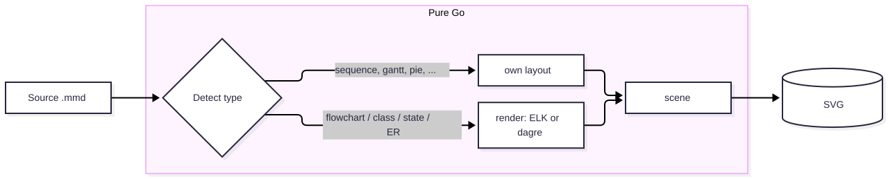
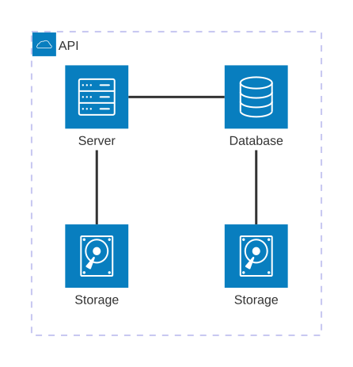
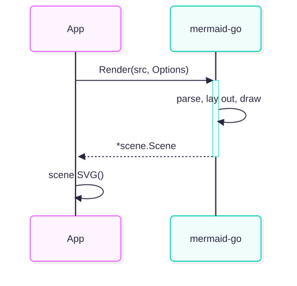

# mermaid-go

Render [Mermaid](https://mermaid.js.org) diagrams in pure Go — no browser, no Node, no headless Chrome.
mermaid-go parses Mermaid source, lays it out and draws it the way mermaid.js 12.2.0 does on
[mermaid.live](https://mermaid.live): same shapes, colours, themes and layout engines. You get a drawing (paths, text,
groups) you can paint yourself, or SVG.

<p>



</p>

## Use

```sh
go get github.com/f1sherb0y/mermaid-go
```

```go
import (
	"os"

	"github.com/f1sherb0y/mermaid-go"
	_ "github.com/f1sherb0y/mermaid-go/diagrams" // registers every diagram type
	"github.com/f1sherb0y/mermaid-go/text"
)

func main() {
	fonts := text.NewFonts()
	// No font is built in: register the families the theme names (mermaid's default
	// is "trebuchet ms", verdana, arial), plus fallbacks for other scripts.
	fonts.AddFile("Recursive Variable", "fonts/RecursiveSansLinear-VF.ttf")
	fonts.AddFile("arial", "/usr/share/fonts/truetype/msttcorefonts/Arial.ttf")
	fonts.AddFile("Noto Sans CJK SC", "/usr/share/fonts/opentype/noto/NotoSansCJK-Regular.ttc")
	fonts.Fallback("Noto Sans CJK SC")

	s, err := mermaid.Render("flowchart LR\n  A --> B", mermaid.Options{
		Fonts:  fonts,
		Config: map[string]any{"theme": "default"}, // what mermaid.initialize would get; optional
	})
	if err != nil {
		panic(err)
	}
	os.WriteFile("out.svg", []byte(s.SVG()), 0o644)
}
```

Text is measured with HarfBuzz shaping (go-text) the way Chrome measures it, so boxes fit their labels. Fonts are
looked up the way a browser resolves a CSS `font-family` list, falling back per character. For the mermaid.live look,
make its font with `python tools/fonts.py <dir>` (Recursive, SIL OFL).

There is a command too:

```sh
go run ./cmd/mermaid -fonts <dir> diagram.mmd out.svg     # or two directories: every .mmd → .svg
```

## Diagrams

| Type | Notes |
|---|---|
| flowchart, class, state, ER, requirement | mermaid's unified renderer; layout ELK (the mermaid 12 default, via elk-go) or `layout: dagre` (a bit-exact port of dagre) |
| sequence | full layout and the neo / classic looks |
| architecture (`architecture-beta`) | a bit-exact port of fcose, plus a grid layout that is used when it is clearly better |
| gantt, xychart, journey, gitGraph, pie, quadrant, radar, sankey, packet, timeline, treemap, treeView, cynefin, info | |

Not yet: mindmap and kanban (nearly done), block, C4, and the newer types (venn, wardley, ishikawa, railroad, …).

Rendering only: clicks, links, tooltips, accessibility text and KaTeX are parsed and dropped.

## How close to mermaid.js

The goal is to look like mermaid.live, not to be pixel-identical. Where matching mermaid would need a hack, mermaid-go
does the clean thing and says so in the package docs. Some input that mermaid.js rejects only because of quirks in
its lexers is drawn normally, for example `A[foo@bar]`, the ER cardinality `many-to-many`, and trailing spaces.

The test suites compare against mermaid.js output captured in Chrome. Dagre matches on all 991 captured cases, and
fcose on 134 of 135. To score your own changes, `tools/ref.mjs` renders references with mermaid.js and compares them
pixel by pixel (see [DESIGN.md](DESIGN.md)).

Some tests and tools also read reference data that is not in this repository: mermaid.js 12.2.0 and the
packages it bundles, the Recursive font mermaid.live draws with, and a corpus of real diagrams with
mermaid.live's dumps. They look for it under `$MERMAID_DATA`, else in `../shitou/data` beside this checkout
(the MeetBuddy repository, where it was made); what is missing is skipped.

Speed: about 1 ms per diagram on average over mermaid's documentation examples, including SVG output.

## Layout of the code

See [DESIGN.md](DESIGN.md). In short:
- `mermaid.go` detects the type and applies the config and theme;
- `diagrams/<type>` parse and draw;
- `render` is mermaid's unified renderer;
- `dagre`, `fcose` and `graph` are layout engines;
- `text` measures, `scene` is the drawing, and SVG comes from `scene`.

## License

MIT. It is a port of MIT, ISC and BSD-licensed JavaScript (mermaid, dagre, fcose, d3, khroma) and includes a patched
copy of go-text/typesetting; see [NOTICE.md](NOTICE.md).
